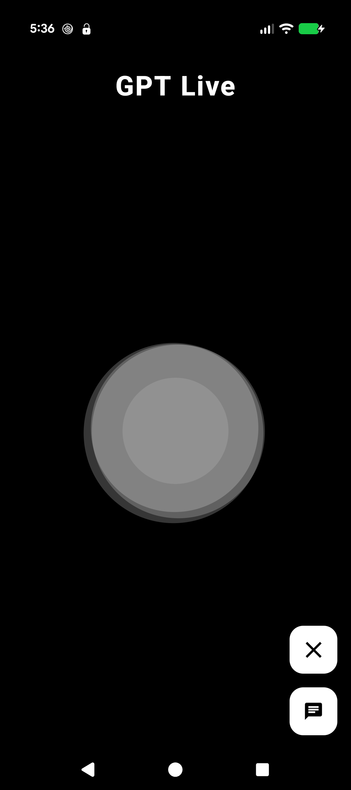
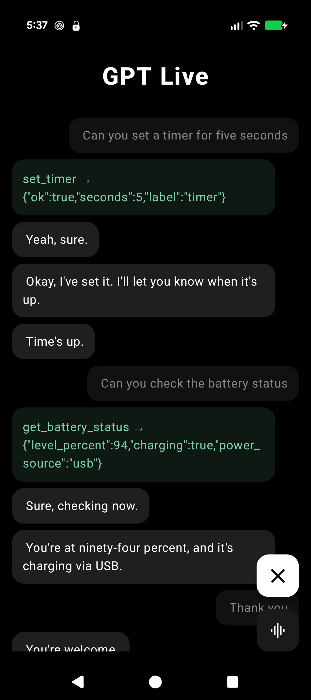
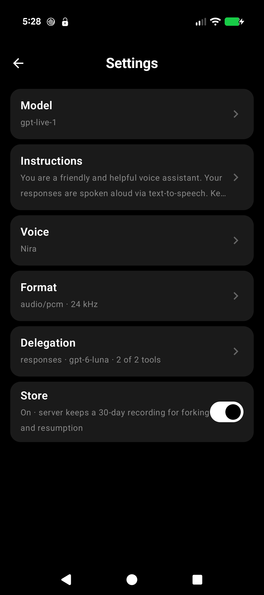

# GPT Live (Android)

A minimal Android voice assistant built on the OpenAI **GPT-Live** WebSocket API
(`wss://api.openai.com/v1/live/sessions`). You talk, it talks back, with native
server-side barge-in, and it can call tools on the phone. Transcripts are stored
locally in Room.

> **Demo app.** The OpenAI key is compiled into the APK from `local.properties`.
> That is fine for trying it on your own phone and wrong for anything you
> distribute. See [Going to production](#going-to-production).

<p align="center">
  
  
  
</p>

## Features

- Kotlin + Jetpack Compose, single activity, no DI framework (a small `ServiceLocator`)
- 24 kHz PCM-16 mono in both directions over one WebSocket
- Adaptive jitter-buffered playback on a dedicated audio thread, so the voice
  stays smooth on a bumpy network
- Always-on speakerphone with platform echo cancellation
- Tool calling through Responses delegation, with two demo tools: battery level
  (read-only, no arguments) and set-a-timer (arguments plus a side effect)
- Settings: editable system prompt, 22 built-in Live voices or a custom
  `voice_…` id, delegation backend model and per-tool on/off switches (pushed
  mid-session with `session.update`), and a server-side session `store` switch
- Session transcripts (user, assistant, and tool calls) persisted with Room
- Graceful shutdown: waits for `session.closed` and surfaces the server's
  close reason (expired, content filter, connection lost)

## API status

GPT-Live 1 (`gpt-live-1`) went GA on the `v1/live/sessions` endpoint on
2026-09-10 at $0.05 per minute of voice, billed per second; backend model and
tool usage is billed separately. This client tracks the GA docs as of
2026-11-05 (no Live changes in the changelog since 2026-10-16):

- No beta header. Only `Authorization: Bearer` is sent.
- Every command carries an `event_id`; errors echo it as `client_event_id`.
- Nine natural voices (German, French, Hindi, Japanese, Korean) added
  2026-10-16, and prompt-to-voice custom voices are usable in Live sessions.
- The recommended delegation backend is `gpt-6-luna`. `gpt-4o`,
  `gpt-4.1-mini` and `gpt-5-mini` are on the deprecations page.
- GPT-Live-1.1 (announced 2026-10-15, 13 new voices and better non-English
  accents) is in ChatGPT but **not in the API yet**; the model id stays
  `gpt-live-1` until OpenAI ships it.
- Native Decisions delegation (2026-10-15) is not used here.

## Quick start

1. Create an OpenAI API key just for this app at
   <https://platform.openai.com/api-keys>.
2. Copy `local.properties.example` to `local.properties` and set
   `OPENAI_API_KEY=sk-...`. An `OPENAI_API_KEY` environment variable also
   works. The build fails fast if it is missing.
3. Open the project in Android Studio (Ladybug or newer, JDK 21) and run it on
   a physical device. Min SDK 26, target SDK 35. The emulator's microphone path
   is poor for this.
4. Tap **Start**, allow the microphone, and talk. Say "how much battery do I
   have left?" or "set a five minute timer for the pasta" to see a tool call.

Revoke the key when you are done. `local.properties` is git-ignored, but the
key is still inside every APK you build.

## How it works

```
Mic (AudioRecord, VOICE_COMMUNICATION + AEC/NS, 20 ms frames)
   └─> OpenAiRealtimeClient.sendPcm  ──base64 JSON──>  GPT-Live session ──> delegated Responses backend
                                                             │                        │
GptLiveViewModel <── RealtimeEvent (audio, transcripts, function calls) ┘ <── response.event ┘
   ├─> playback queue ──> "gptlive-playback" thread ──> AudioTrack (24 kHz)
   └─> LiveTool.execute ──> response.item.create + response.create ──> backend
```

| File | Role |
| --- | --- |
| `audio/AudioCapture.kt` | Mic capture on an `URGENT_AUDIO` thread, 200 ms record buffer, `VOICE_COMMUNICATION` source with AEC + NS enabled |
| `realtime/OpenAiRealtimeClient.kt` | WebSocket client: `session.start`, audio in/out, transcript deltas, delegation and tool-call events, `session.update`, usage, graceful close |
| `GptLiveViewModel.kt` | Session lifecycle, speakerphone routing, adaptive jitter buffer, transcript segmentation, tool execution |
| `tools/LiveTool.kt`, `tools/BatteryTool.kt`, `tools/TimerTool.kt` | Function tools offered to the delegated backend. `BatteryTool` is a read-only, no-argument call; `TimerTool` takes arguments and starts a timer in the clock app |
| `prefs/ApiKeyProvider.kt` | Supplies the bearer token. The demo reads `BuildConfig.OPENAI_API_KEY`; this is the seam to replace in production |
| `prefs/LocalPrefs.kt`, `prefs/LiveVoices.kt`, `prefs/DelegationModels.kt` | Persisted settings and the pick lists behind them |
| `data/` | Room database for sessions and messages |
| `ui/` | Compose screens: setup, live session with audio orb, settings, prompt editor, voice picker, delegation |

### Playback pipeline

GPT-Live sends 100 ms audio chunks at roughly real-time pace, with network
jitter, and omits silence. On OpenAI's endpoint the audio deltas carry no
timing fields (Azure's add `start_ms`/`end_ms`; the client passes them
through when present). There is no output-audio-done event. A fixed buffer
is not enough: any drift slowly eats
the reserve until the track runs dry mid-word, and every `AudioTrack` underrun
is an audible click. The player is therefore an adaptive jitter buffer on a
dedicated audio-priority thread:

1. Chunks are queued as they arrive and `play()` starts once `PREROLL_MS`
   (200 ms) is buffered.
2. If a chunk is late and the reserve drops below `LOW_WATER_MS`, 20 ms slices
   of silence with 8 ms fades are padded in. The hardware never runs dry, and
   the reserve grows to match the jitter actually observed.
3. After a real pause (more than `REBUILD_AFTER_PAD_MS` of padding) the next
   chunks are held until a full pre-roll is queued again, so a new sentence
   never starts on an empty reserve.
4. After `MAX_PAD_MS` of silence the track is parked until the next chunk.
5. Underruns and every stretch are logged under the `GptLiveVM` tag.

The constants live at the top of `GptLiveViewModel.kt`.

### Audio routing

Audio is hard-wired to speakerphone: `MODE_IN_COMMUNICATION`, the built-in
speaker as communication device, and `USAGE_VOICE_COMMUNICATION` output. The
mic uses the `VOICE_COMMUNICATION` source with the platform acoustic echo
canceller and noise suppressor enabled, so the model does not hear itself.
Very quiet interruptions during playback may be attenuated by the canceller.

### Transcripts

GPT-Live has no "turn done" event. The app groups transcript deltas into
bubbles by gaps on the server timeline (`TURN_GAP_MS`), and treats the playback
buffer draining as the end of the assistant's speech.

## Tool calling

GPT-Live itself only listens and speaks. When it needs facts or an action it
*delegates* to a backend Responses model, configured under
`delegation.responses` in `session.start`. Function tools are declared there.
When the backend calls one, the app runs it and returns the result:

```
GPT-Live ── session.delegation.created ──> app (shows "thinking")
Backend  ── response.event { response.output_item.done, function_call } ──> app
app      ── response.item.create { function_call_output } + response.create ──> backend
Backend answer ──> injected into the live session ──> spoken as normal audio
```

GPT-Live decides on its own whether to delegate. When tools are registered,
the client appends a short rule to the Live instructions listing them and
telling the model to delegate rather than answer from memory. Without that
rule it will confidently say it cannot check.

**Adding a tool.** Implement `LiveTool` (a name, a description, JSON-Schema
parameters, and a suspend `execute`) and add it to the `tools` list in
`ServiceLocator`. It then appears under Settings → Delegation, where it can be
switched off. The call and its result show up as a green bubble in the
transcript and are stored with the session.

Notes:

- The session uses `parallel_tool_calls: false`, so every call is answered
  with one result plus one `response.create`. Enable parallel calls only if
  you batch all outputs before continuing.
- Tool output goes to the model verbatim and is read aloud, so keep it short.
- Hosted tools such as `{ "type": "web_search" }` can be added to the same
  list and run entirely server-side.
- Tool errors are returned to the model as `{"error": ...}` so it can explain
  instead of stalling.

## Settings

| Row | What it does |
| --- | --- |
| Model | Fixed: `gpt-live-1` |
| Instructions | System prompt for the voice model (up to 16k tokens). Changes mid-session are sent with `session.instructions.append` (500 tokens per append) |
| Voice | One of the 22 built-in GPT-Live voices, or a custom `voice_…` id (sent as `{ "id": ... }`). Applies to the next session; the voice is immutable after startup |
| Format | Fixed: `audio/pcm` at 24 kHz |
| Delegation | Backend Responses model (a few suggestions plus a free-text id) and a switch per tool. Changes during a session are pushed with `session.update`, which replaces the whole `delegation` object |
| Store | Sends `store: true` so the server keeps a 30-day recording for forking or resumption. Off by default; requires an account data policy that allows retention |

The session also reports `session.usage.updated` about once a minute
(cumulative billed seconds and context-window ratio); the ViewModel keeps the
latest values in `AgentUiState`.

## Voices

The voice picker offers the 22 built-in GPT-Live voices (list as of
2026-10-16). "Natural" voices are modelled on a recorded speaker; the rest are
generated. The id is what goes in `session.start`.

| Voice | Id | Language | Accent | Style | Natural |
| --- | --- | --- | --- | --- | --- |
| Marin (default) | `marin` | | | | |
| Quartz | `quartz` | English | Australian | Feminine | |
| Ripple | `ripple` | English | Australian | Masculine | ✓ |
| Vesper | `vesper` | English | British | Masculine | ✓ |
| Willow | `willow` | English | Irish | Feminine | ✓ |
| Stone | `stone` | English | Irish | Masculine | ✓ |
| Gleam | `gleam` | English | North American | Feminine | ✓ |
| Meridian | `meridian` | English | North American | Masculine | ✓ |
| Beacon | `beacon` | English | Filipino | Masculine | |
| Delta | `delta` | English | Southern U.S. | Feminine | |
| Cinder | `cinder` | English | Southern U.S. | Masculine | |
| Bossa | `bossa` | Portuguese | Brazilian | Feminine | ✓ |
| Tempo | `tempo` | Portuguese | Brazilian | Masculine | ✓ |
| Nuri | `nuri` | German | | Feminine | ✓ |
| Juni | `juni` | German | | Feminine | ✓ |
| Flitz | `flitz` | German | | Masculine | ✓ |
| Brise | `brise` | French | | Feminine | ✓ |
| Sillage | `sillage` | French | | Masculine | ✓ |
| Nira | `nira` | Hindi | | Feminine | ✓ |
| Harema | `harema` | Japanese | | Feminine | ✓ |
| Shida | `shida` | Japanese | | Masculine | ✓ |
| Noeul | `noeul` | Korean | | Feminine | ✓ |

A custom voice from prompt-to-voice or cloning works too: enter its
`voice_…` id in the picker. The list lives in `prefs/LiveVoices.kt`.

## Smoke test with logcat

Filter on the `GptLiveClient` and `GptLiveVM` tags. A healthy session with a
tool call looks like this:

```
AudioCapture: Audio session=... aec=true ns=true
GptLiveClient: session.start sent model=gpt-live-1 voice=marin delegation=gpt-6-luna tools=1 store=false
GptLiveClient: ← session.started id=sess_... expires_at=... delegation={"type":"responses",...}
GptLiveVM:     AudioTrack created buf=14400 frames preroll=200ms
GptLiveVM:     playback started with 200 ms buffered
GptLiveClient: ← delegation.created id=item_... target=responses
GptLiveClient: ← function_call get_battery_status({}) call_id=call_...
GptLiveClient: → function_call_output call_id=call_... + response.create
GptLiveClient: ← delegated response completed usage={...}
GptLiveClient: ← usage seconds=61 context=4%
GptLiveClient: ← session.closed reason=close_requested seconds=128
```

Things to watch for:

- `session.closed not received within 2000ms` means the server never
  confirmed the close; usage for that session is unconfirmed.
- `← error [...] client_event_id=update_3` ties a rejected command back to
  the `session.update` (or other command) that caused it.

- `AudioTrack underrun count=N` means the hardware ran dry. It should not
  appear; if it does, raise `PREROLL_MS` or `LOW_WATER_MS`.
- `stretched by N ms` shows the jitter buffer absorbing a late chunk. A few
  per minute is normal; a flood means a bad network.
- No `delegation.created` after a question a tool could answer means the
  voice model answered from memory. Strengthen the system prompt.

## Going to production

Anyone with the APK can extract a compiled-in key with `apktool` or `strings`
and run up your bill. Before distributing the app:

1. Stand up a small backend that holds your real OpenAI key. The GA Live
   WebSocket guide expects the key to stay on a trusted server, so either
   proxy the Live WebSocket through that backend, or have it mint a
   short-lived client credential if OpenAI documents one for Live by the
   time you ship (the Realtime API has `client_secrets`; Live WebSocket did
   not list an equivalent as of 2026-11-05).
2. Implement `ApiKeyProvider` with a call to that endpoint and register it in
   `ServiceLocator` in place of `BuildConfigApiKeyProvider`. Cache the token in
   memory and re-fetch shortly before it expires.
3. Remove `OPENAI_API_KEY` from the Gradle config so a real key can never be
   built into the app by accident.

Authenticate the backend endpoint with something the app can actually keep
secret, such as a signed-in user session or Play Integrity, rather than a
static app key.

## References

- [Getting started with GPT-Live](https://developers.openai.com/api/docs/guides/live)
- [Live over WebSockets](https://developers.openai.com/api/docs/guides/voice-websockets?api=live)
- [Managing GPT-Live sessions and voice options](https://developers.openai.com/api/docs/guides/live-conversations)
- [Delegation and tools](https://developers.openai.com/api/docs/guides/live-delegation)
- [Custom voices](https://developers.openai.com/api/docs/guides/custom-voices)
- [API changelog](https://developers.openai.com/api/docs/changelog)
- [GPT-Live event reference](https://learn.microsoft.com/en-us/azure/foundry/openai/gpt-live-reference)
- [Delegate work in GPT-Live](https://learn.microsoft.com/en-us/azure/foundry/openai/how-to/gpt-live-delegation)
